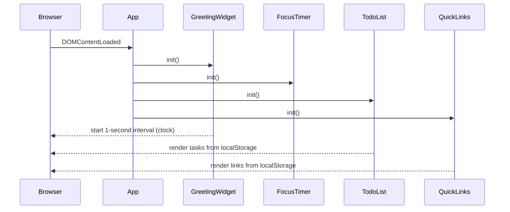
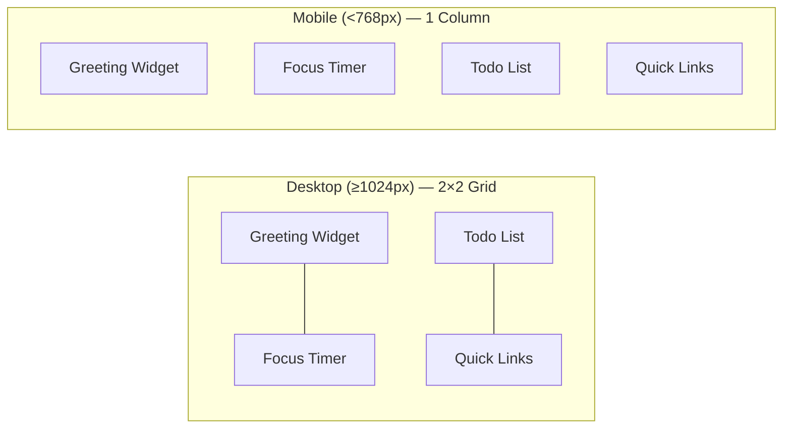
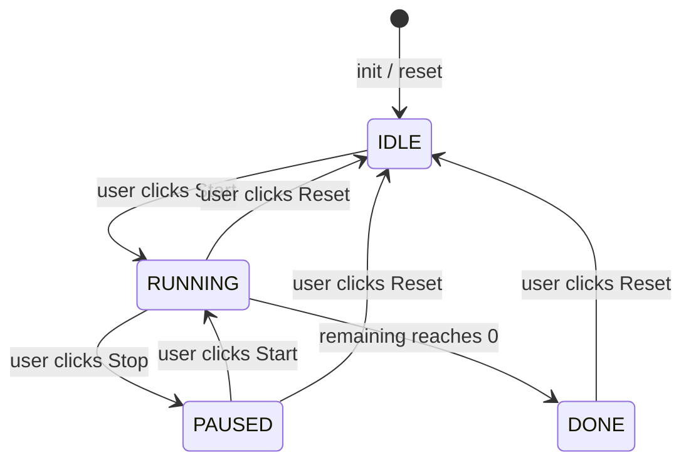

# Design Document: Todo List Life Dashboard

## Overview

The Todo List Life Dashboard is a single-page web application (SPA) implemented entirely with pure HTML5, CSS3, and vanilla JavaScript (ES6+). It runs client-side only — no server, no build step, no external frameworks — making it deployable by simply opening `index.html` in a browser.

The application is composed of four independent widgets rendered side-by-side on a single screen:

| Widget | Responsibility |
|---|---|
| Greeting Widget | Live clock, date, and time-of-day greeting |
| Focus Timer | Pomodoro-style 25-minute countdown |
| Todo List | CRUD task management with Local Storage persistence |
| Quick Links | Named-URL bookmark management with Local Storage persistence |

**Key constraints from requirements:**
- Zero external network requests after initial load (Requirement 10.5)
- All data persisted via `localStorage` only (Requirement 7, 8)
- Single HTML file entry point, single CSS file at `css/`, single JS file at `js/` (Requirement 10.3, 10.4)
- Must render correctly in Chrome, Firefox, Edge, and Safari stable releases (Requirement 10.6)

---

## Architecture

### Module Structure

The single JavaScript file is organised as a set of immediately-invoked module objects (IIFE-based namespaces) to keep concerns separated without a module bundler. Each widget owns its own namespace with an `init()` entry point called by a top-level `App.init()` on `DOMContentLoaded`.

```
App (top-level coordinator)
├── GreetingWidget   — clock, date, greeting logic
├── FocusTimer       — countdown state machine
├── TodoList         — task CRUD + LocalStorage
└── QuickLinks       — link CRUD + LocalStorage
```

### File Layout

```
index.html          ← single HTML entry point
css/
  style.css         ← all styling (layout, widgets, responsive)
js/
  app.js            ← all JavaScript (all four widget modules + App)
```

### Execution Flow



### Responsive Layout

A CSS Grid two-column layout handles desktop view (≥ 1024 px). A single media query at 768 px switches to a single-column stack.



---

## Components and Interfaces

### App (Coordinator)

Bootstraps all widgets after the DOM is ready. Has no persistent state of its own.

```javascript
const App = {
  init() {
    GreetingWidget.init();
    FocusTimer.init();
    TodoList.init();
    QuickLinks.init();
  }
};
document.addEventListener('DOMContentLoaded', () => App.init());
```

---

### GreetingWidget

**Responsibilities:** Display the live time (HH:MM:SS or 12-hour with AM/PM), the formatted date, and a time-of-day greeting. Refresh every second via `setInterval`.

**Public interface:**
```javascript
GreetingWidget = {
  init(),              // bind DOM elements, start interval
  _tick(),             // called every second — update time, date, greeting
  _formatTime(date),   // → string  e.g. "09:05:32" or "09:05:32 AM"
  _formatDate(date),   // → string  e.g. "Monday, 14 July 2025"
  _getGreeting(hour),  // → string  one of the four greeting phrases
}
```

**Greeting logic:**

| Hour range | Greeting |
|---|---|
| 05 – 11 | "Good Morning" |
| 12 – 16 | "Good Afternoon" |
| 17 – 20 | "Good Evening" |
| 21 – 04 (wraps midnight) | "Good Night" |

**DOM targets:**
- `#greeting-text` — greeting phrase
- `#time-display` — formatted time string
- `#date-display` — formatted date string

---

### FocusTimer

**Responsibilities:** A 25-minute (1500-second) countdown with Start, Stop, and Reset controls. Manages a small internal state machine.

**State machine:**



**States:**
- `IDLE` — countdown shows 25:00; Start enabled, Stop disabled
- `RUNNING` — countdown decrementing; Start disabled, Stop enabled
- `PAUSED` — countdown frozen; Start enabled, Stop disabled
- `DONE` — countdown shows 00:00, completion indicator visible; Start disabled, Stop disabled

**Public interface:**
```javascript
FocusTimer = {
  init(),              // bind DOM elements and controls
  _start(),            // IDLE/PAUSED → RUNNING
  _stop(),             // RUNNING → PAUSED
  _reset(),            // any → IDLE
  _tick(),             // decrement remaining; detect DONE
  _render(),           // update #timer-display + button states + completion indicator
  _formatTime(secs),   // → "MM:SS" string
}
```

**DOM targets:**
- `#timer-display` — MM:SS string
- `#timer-start` — Start button
- `#timer-stop` — Stop button
- `#timer-reset` — Reset button
- `#timer-complete` — completion indicator (hidden/shown)

---

### TodoList

**Responsibilities:** Full CRUD for tasks. Each task has an `id`, `text`, and `completed` flag. All mutations persist to `localStorage` immediately.

**Public interface:**
```javascript
TodoList = {
  init(),                    // load from storage, render all tasks
  _addTask(text),            // validate + append + persist + render
  _editTask(id, newText),    // validate + update + persist + re-render task
  _deleteTask(id),           // remove + persist + re-render list
  _toggleComplete(id),       // flip completed flag + persist + re-render task
  _save(),                   // JSON.stringify tasks → localStorage
  _load(),                   // JSON.parse from localStorage → tasks array
  _renderList(),             // clear #todo-list, re-render all tasks
  _renderTask(task),         // → HTMLElement for one task row
  _enterEditMode(id),        // swap display span → input field
  _exitEditMode(id, save),   // swap input → display span, optionally save
}
```

**DOM targets:**
- `#todo-input` — new task text input
- `#todo-add` — Add button
- `#todo-list` — `<ul>` container for task items

**Task item structure (per task):**
```html
<li data-id="{id}">
  <input type="checkbox" class="todo-complete" />
  <span class="todo-text">{text}</span>
  <button class="todo-edit">Edit</button>
  <button class="todo-delete">Delete</button>
</li>
```

When in edit mode, the `<span>` is replaced with:
```html
<input type="text" class="todo-edit-input" value="{text}" />
<button class="todo-save">Save</button>
<button class="todo-cancel">Cancel</button>
```

---

### QuickLinks

**Responsibilities:** Manage a list of named URL bookmarks. Each link has an `id`, `name`, and `url`. All mutations persist to `localStorage` immediately.

**Public interface:**
```javascript
QuickLinks = {
  init(),                // load from storage, render all links
  _addLink(name, url),  // validate + append + persist + render
  _deleteLink(id),       // remove + persist + re-render
  _save(),               // JSON.stringify links → localStorage
  _load(),               // JSON.parse from localStorage → links array
  _renderList(),         // clear #links-list, re-render all links
  _renderLink(link),     // → HTMLElement for one link button + delete control
  _showError(msg),       // display validation error in #links-error
  _clearError(),         // hide #links-error
}
```

**DOM targets:**
- `#links-name` — name input field
- `#links-url` — URL input field
- `#links-add` — Add Link button
- `#links-error` — inline error message area
- `#links-list` — container for rendered link buttons

**Link item structure (per link):**
```html
<div class="link-item">
  <button class="link-open" data-url="{url}" target="_blank">{name}</button>
  <button class="link-delete" data-id="{id}">Delete</button>
</div>
```

---

## Data Models

### Task (Todo List)

```javascript
/**
 * @typedef {Object} Task
 * @property {string}  id        - Unique identifier (Date.now().toString() + Math.random())
 * @property {string}  text      - Task description (non-empty, trimmed)
 * @property {boolean} completed - Completion state; false on creation
 */
```

**Local Storage key:** `"todo_tasks"`  
**Storage format:** JSON array of Task objects

```json
[
  { "id": "1720958400000.123", "text": "Buy groceries", "completed": false },
  { "id": "1720958500000.456", "text": "Read chapter 3", "completed": true }
]
```

### Link (Quick Links)

```javascript
/**
 * @typedef {Object} Link
 * @property {string} id   - Unique identifier (Date.now().toString() + Math.random())
 * @property {string} name - User-provided display label (non-empty, trimmed)
 * @property {string} url  - User-provided URL (non-empty, trimmed)
 */
```

**Local Storage key:** `"quick_links"`  
**Storage format:** JSON array of Link objects

```json
[
  { "id": "1720958600000.789", "name": "GitHub", "url": "https://github.com" },
  { "id": "1720958700000.012", "name": "MDN Docs", "url": "https://developer.mozilla.org" }
]
```

### FocusTimer State (in-memory only)

```javascript
/**
 * @typedef {Object} TimerState
 * @property {number} remaining  - Seconds remaining (0–1500)
 * @property {'IDLE'|'RUNNING'|'PAUSED'|'DONE'} status
 * @property {number|null} intervalId - setInterval handle, or null when not running
 */
```

The Focus Timer state is intentionally **not persisted** to localStorage. Requirement 3.1 specifies that the timer resets to 25:00 on every page load.

---

## Correctness Properties

*A property is a characteristic or behavior that should hold true across all valid executions of a system — essentially, a formal statement about what the system should do. Properties serve as the bridge between human-readable specifications and machine-verifiable correctness guarantees.*

### Property 1: Greeting maps every hour of the day to exactly one phrase

*For any* integer hour value in the range [0, 23], `_getGreeting(hour)` SHALL return exactly one of the four valid greeting strings ("Good Morning", "Good Afternoon", "Good Evening", "Good Night") and SHALL never return undefined or any other string.

**Validates: Requirements 2.1, 2.2, 2.3, 2.4**

---

### Property 2: Valid task addition grows the list by exactly one

*For any* task list of arbitrary length and any non-empty, non-whitespace-only string, calling `_addTask(text)` SHALL increase the task count by exactly 1, and the new task SHALL appear at the end of the list with `completed = false`.

**Validates: Requirements 4.2, 4.4**

---

### Property 3: Whitespace-only task descriptions are always rejected

*For any* string composed entirely of whitespace characters (spaces, tabs, newlines), calling `_addTask(text)` SHALL reject the submission, leaving the task list unchanged.

**Validates: Requirements 4.3**

---

### Property 4: Task persistence round-trip

*For any* array of Task objects, serializing it to localStorage via `_save()` and then deserializing it via `_load()` SHALL produce an array that is deep-equal to the original (same ids, text values, and completion states, in the same order).

**Validates: Requirements 4.4, 7.1, 7.3**

---

### Property 5: Task completion toggle is an involution

*For any* task, toggling its completion state twice (via `_toggleComplete`) SHALL return the task to its original `completed` value (i.e., `toggle(toggle(x)) === x`).

**Validates: Requirements 6.2, 6.3**

---

### Property 6: Edit with whitespace-only text is always rejected

*For any* task with an existing description, calling `_editTask(id, text)` with a whitespace-only string SHALL leave the task description unchanged.

**Validates: Requirements 5.4**

---

### Property 7: Link persistence round-trip

*For any* array of Link objects, serializing it to localStorage via `_save()` and then deserializing it via `_load()` SHALL produce an array that is deep-equal to the original (same ids, names, and URLs, in the same order).

**Validates: Requirements 8.4, 9.3**

---

### Property 8: Missing-field link submission is always rejected

*For any* combination of inputs where either the name or the URL is empty or whitespace-only, calling `_addLink(name, url)` SHALL reject the submission, leaving the link list unchanged and displaying a visible error.

**Validates: Requirements 8.3**

---

### Property 9: Timer format always produces valid MM:SS

*For any* integer number of seconds in the range [0, 1500], `_formatTime(secs)` SHALL return a string matching the regular expression `^\d{2}:\d{2}$` where the minutes portion is in [00, 25] and the seconds portion is in [00, 59].

**Validates: Requirements 3.2**

---

### Property 10: Timer countdown is monotonically non-increasing

*For any* sequence of `_tick()` calls while the timer is in the RUNNING state, the `remaining` value SHALL decrease by exactly 1 on each tick and SHALL never go below 0.

**Validates: Requirements 3.3, 3.6**

---

### Property 11: Task deletion removes exactly the targeted task

*For any* task list containing at least one task and any valid task `id` in that list, calling `_deleteTask(id)` SHALL reduce the list length by exactly 1 and the resulting list SHALL contain no task with the deleted `id`.

**Validates: Requirements 6.5, 6.6**

---

### Property 12: Link render output contains the link's name and URL

*For any* Link object with a non-empty `name` and `url`, calling `_renderLink(link)` SHALL produce a DOM element whose text content includes the link's `name` and whose navigable URL attribute contains the link's `url`.

**Validates: Requirements 9.1, 9.2**

---

## Error Handling

| Scenario | Handling Strategy |
|---|---|
| `localStorage` read returns `null` (no saved data) | `_load()` returns `[]`; widgets render empty state without errors (Req 7.2, 9.4) |
| `localStorage` read returns malformed JSON | `JSON.parse` wrapped in `try/catch`; falls back to `[]` and logs a console warning |
| `localStorage` write throws (e.g., storage quota exceeded) | `_save()` wrapped in `try/catch`; logs a console error; UI still reflects in-memory state |
| Empty/whitespace task submission | Reject silently; retain focus on input field (Req 4.3) |
| Empty field link submission | Display inline error message in `#links-error` indicating which field is missing (Req 8.3) |
| Task edit confirmed with empty text | Reject; restore original text; exit edit mode (Req 5.4) |
| Timer reaches 00:00 while `_tick` is called | Clamp remaining to 0, clear interval, transition to DONE state (Req 3.6, 3.7) |

---

## Testing Strategy

This feature is a pure-frontend application with significant business logic (time-of-day categorisation, input validation, state machine transitions, serialisation round-trips). Property-based testing is appropriate for the logic-heavy modules.

### Property-Based Testing Library

**[fast-check](https://github.com/dubzzz/fast-check)** (JavaScript) — imported as a dev dependency or loaded from CDN in test files. Configured to run **minimum 100 iterations per property**.

Tag format for each property test:
```
// Feature: todo-list-life-dashboard, Property {N}: {property_text}
```

### Unit Tests (example-based)

Focused on specific scenarios, integration points, and edge cases not covered by properties:

- FocusTimer state machine transitions (IDLE → RUNNING → PAUSED → IDLE, etc.)
- FocusTimer button enable/disable states in each state
- Completion indicator visibility (shown only in DONE state)
- TodoList renders persisted tasks on `init()` (integration with `_load`)
- QuickLinks opens URL in new tab (`target="_blank"` or `window.open`)
- Dashboard renders all four widgets with no JS errors on load
- GreetingWidget updates time display every second (spy on `setInterval`)

### Property Tests

Each of the 10 correctness properties maps to one property-based test:

| Property | Generator | What varies |
|---|---|---|
| P1: Greeting maps every hour | `fc.integer({min:0, max:23})` | hour value |
| P2: Valid task grows list | `fc.array(taskArb) × fc.string()` | existing tasks + new text |
| P3: Whitespace rejected | `fc.stringOf(fc.constantFrom(' ','\t','\n'))` | whitespace-only strings |
| P4: Task persistence round-trip | `fc.array(taskArb)` | arbitrary task arrays |
| P5: Toggle is involution | `taskArb` | arbitrary task objects |
| P6: Edit whitespace rejected | `taskArb × fc.stringOf(...)` | existing task + whitespace text |
| P7: Link persistence round-trip | `fc.array(linkArb)` | arbitrary link arrays |
| P8: Missing-field link rejected | `fc.option(fc.string()) × fc.option(fc.string())` | missing name/url combinations |
| P9: Timer format is valid MM:SS | `fc.integer({min:0, max:1500})` | any second value in range |
| P10: Timer countdown monotone | `fc.integer({min:1, max:1500})` | any starting remaining value |
| P11: Delete removes targeted task | `fc.array(taskArb, {minLength:1}) × fc.nat()` | task arrays + deletion index |
| P12: Link render contains name and URL | `linkArb` | arbitrary link objects |

### Test File Location

```
js/
  app.js
tests/
  greeting.test.js     ← P1 + greeting unit tests
  timer.test.js        ← P9, P10 + state machine unit tests
  todolist.test.js     ← P2, P3, P4, P5, P6 + CRUD unit tests
  quicklinks.test.js   ← P7, P8 + link management unit tests
```

Test runner: **[Vitest](https://vitest.dev/)** (or Jest — both support fast-check via the standard import). Run with `vitest --run` for a single, non-watch execution.
